# SleepTrack Web

[](https://github.com/KhaledSaeed18/sleep-track-frontend/actions/workflows/ci.yml)


SleepTrack is a sleep journal that explains your nights. Log sleep in a few seconds or tap a timer
at bedtime, tag nights with things like caffeine, exercise or stress, and SleepTrack turns that
history into a nightly score, trends, a chronotype estimate, the habits that help or hurt you, and a
weekly report.

This repository is the web app, built with Next.js (App Router) and daisyUI. It talks to the
[SleepTrack API](https://github.com/KhaledSaeed18/sleep-track-backend) (FastAPI, PostgreSQL, Redis)
through a same-origin proxy, with types generated from the API's OpenAPI schema.

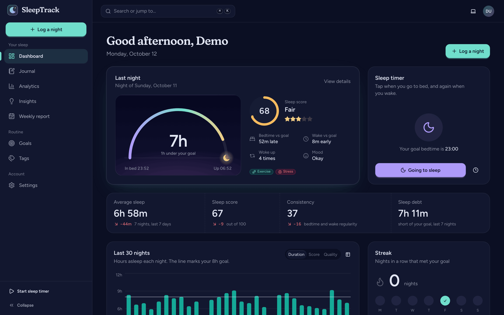

## Contents

- [Features](#features)
- [Screenshots](#screenshots)
- [Tech stack](#tech-stack)
- [Quick start](#quick-start)
- [Configuration](#configuration)
- [Scripts](#scripts)
- [Testing](#testing)
- [Docker and deployment](#docker-and-deployment)
- [Project structure](#project-structure)
- [Further reading](#further-reading)

## Features

**Your nights**

- **Dashboard:** the most recent night drawn as a horizon arc from bedtime to wake, its score and
  breakdown, a one-tap sleep timer, key stats with change against the previous period, a 30-night
  trend and the current goal streak.
- **Sleep timer:** start it at bedtime (or backdate it), then stop it in the morning with a short
  check-in for quality, mood, awakenings and tags. A running timer stays visible across the app.
- **Journal:** search notes and filter by date range, quality and tags, sort, paginate, select
  nights for bulk delete, and export. Overlapping or impossible nights are rejected with clear,
  field-level messages.
- **Night detail:** a timeline from bed to sleep to wake, quality, mood, latency, awakenings, notes,
  tags and an explanation of how the score was calculated.

**Understanding them**

- **Analytics:** 7/30/90-day, yearly or custom ranges with a nightly trend, a "when you sleep"
  bedtime-to-wake chart against your bedtime window, weekday patterns, duration, quality and bedtime
  distributions, tag impact, a chronotype estimate with social jet lag, and a year heatmap of scores.
- **Insights:** plain-language findings ranked by importance and grouped by topic (duration, habits,
  consistency, timing, routine), for example "Caffeine lowers your sleep quality".
- **Weekly report:** any week at a glance with its best and toughest nights and what stood out,
  ready to print or email to yourself.
- **Goals and tags:** set a target duration, bedtime, wake time and bedtime window with
  recommendations for your age, and manage your own tags with usage counts.

**Account and app**

- Email and password sign-up with live password strength, email verification, password reset,
  remember-me, Google sign-in when the API enables it, and a **one-click live demo** with 90 nights
  of sample data.
- Settings for profile, preferences (time zone, 12/24-hour clock, week start, theme, emails),
  security (change password, signed-in devices, sign out everywhere, activity log) and data (JSON or
  CSV export, CSV import, account deletion).
- An **admin area** with usage stats, a sign-up chart and user management (role, active status).
- A **command menu** (<kbd>⌘</kbd>/<kbd>Ctrl</kbd> <kbd>K</kbd>) and keyboard shortcuts for every
  page (<kbd>G</kbd> then <kbd>D</kbd>, <kbd>N</kbd> to log a night, <kbd>?</kbd> for the list).
- Two hand-tuned themes, **Midnight** and **Dawn**, that follow the system setting or your choice,
  with no flash on load.
- Built mobile-first: a bottom dock with a quick-log button on phones and a collapsible sidebar on
  desktop.
- Accessible by default: semantic landmarks, a skip link, labelled controls, focus management in
  dialogs, reduced-motion support and a data-table view for the charts.
- A landing page, legal pages, SEO metadata, sitemap, robots, generated Open Graph images and a web
  manifest.

## Screenshots

|                                                    |                                                      |
| -------------------------------------------------- | ---------------------------------------------------- |
| 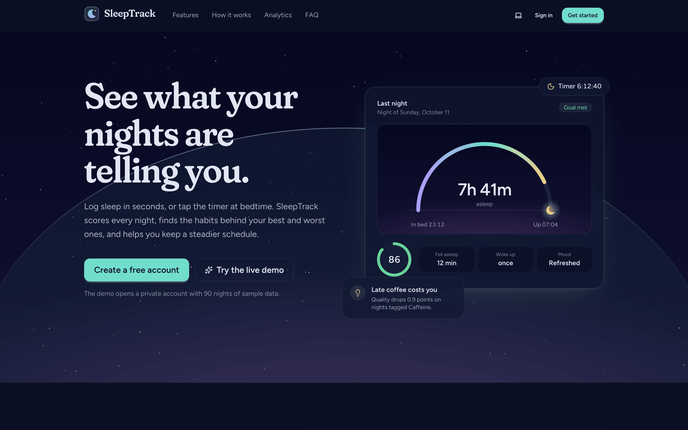      | 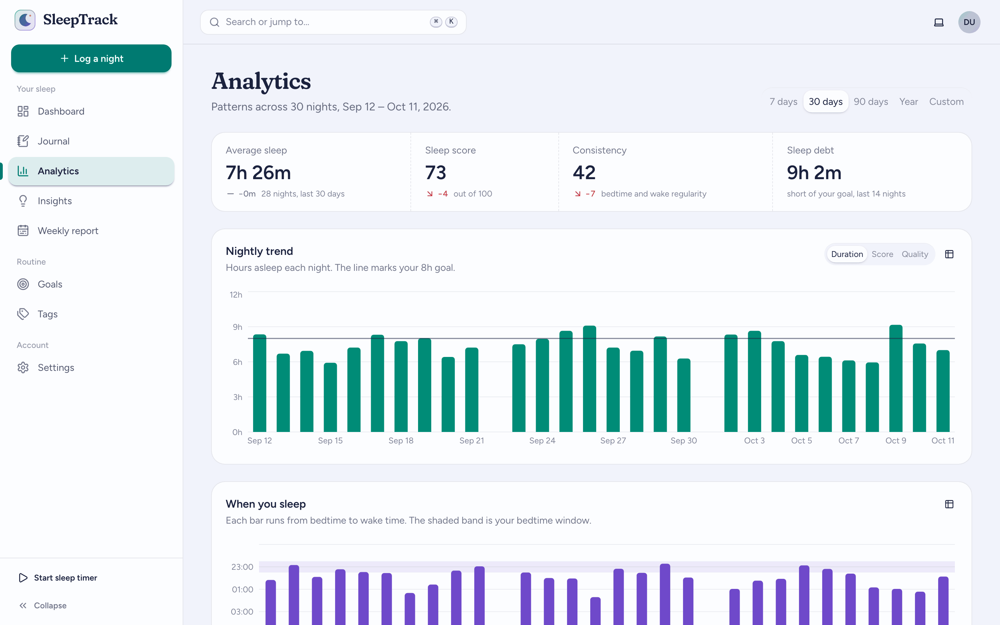    |
| Landing page                                       | Analytics in the Dawn theme                          |
| 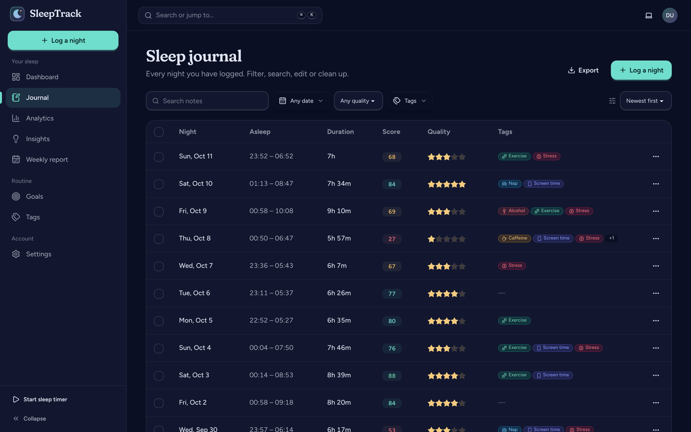           | 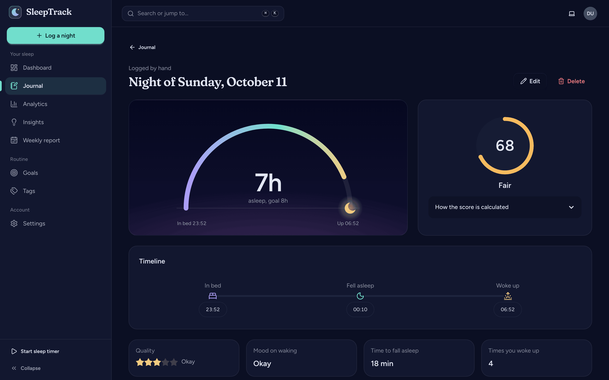   |
| Journal                                            | Night detail                                         |
| 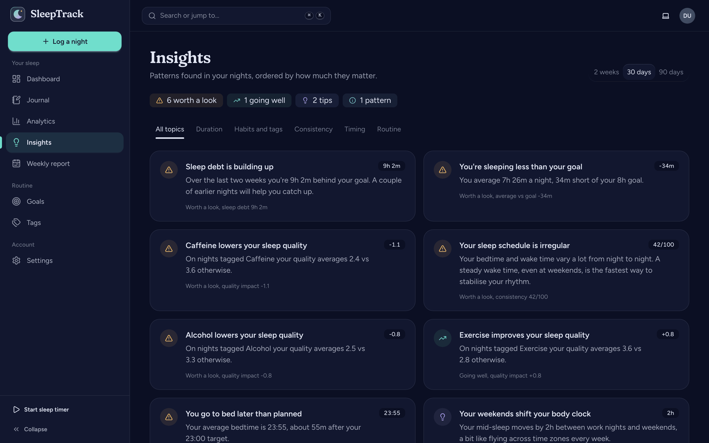         | 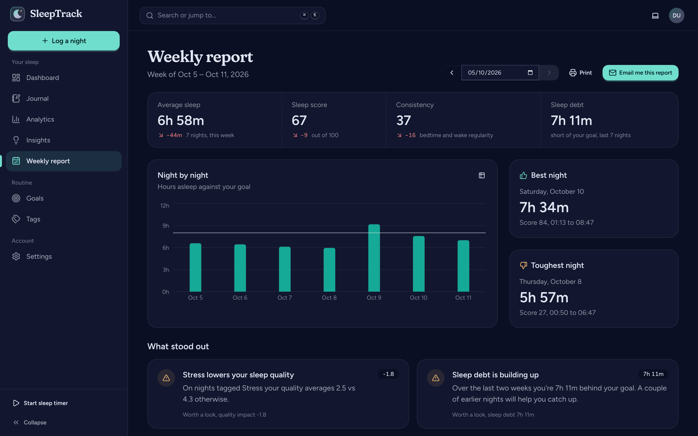 |
| Insights                                           | Weekly report                                        |
| 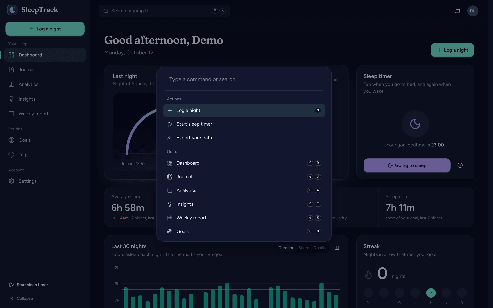 | 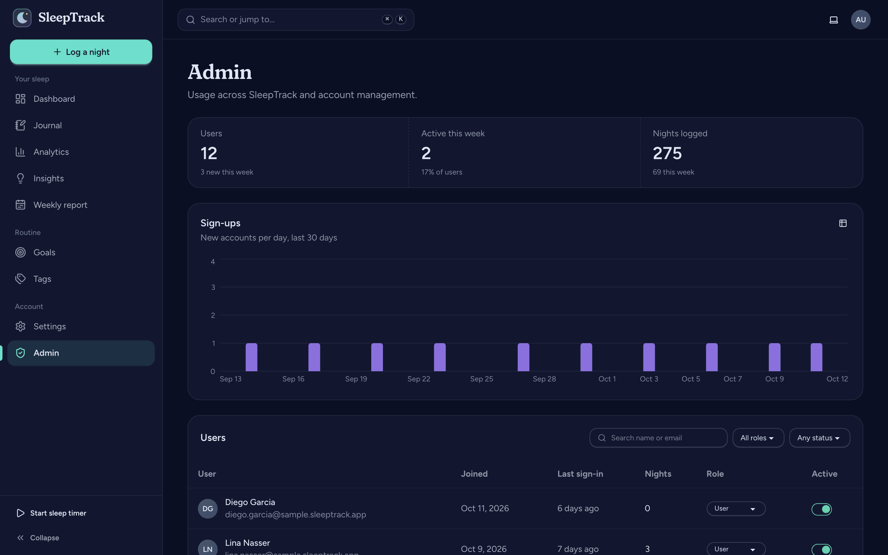                 |
| Command menu                                       | Admin                                                |

<p>
  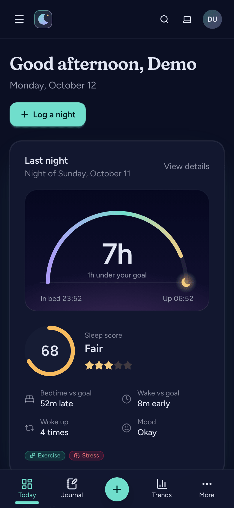
  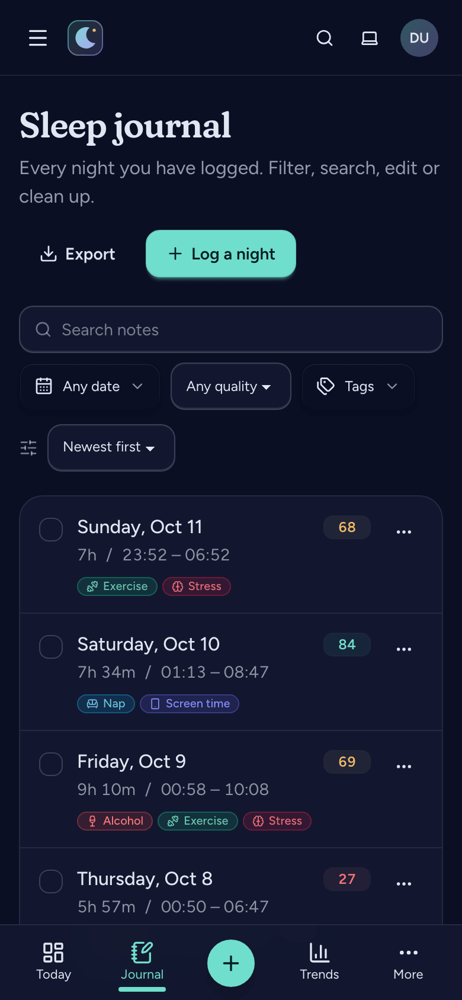
</p>

The full analytics page is in [`docs/screenshots/analytics.png`](docs/screenshots/analytics.png).
Run `pnpm screenshots` to regenerate them.

## Tech stack

| Concern                 | Choice                                                                           |
| ----------------------- | -------------------------------------------------------------------------------- |
| Framework               | Next.js 16 (App Router, React Compiler, standalone output), React 19             |
| Language                | TypeScript (strict, `noUncheckedIndexedAccess`)                                  |
| Styling                 | Tailwind CSS 4 and daisyUI 5 with custom `midnight` and `dawn` themes            |
| Server state            | TanStack Query 5                                                                 |
| Client state            | Zustand (UI and auth status), URL state with nuqs (filters, ranges, report week) |
| API client              | openapi-fetch with types generated by openapi-typescript                         |
| Forms                   | react-hook-form and zod 4                                                        |
| Charts                  | Recharts 3                                                                       |
| Icons                   | lucide-react                                                                     |
| Dates                   | date-fns 4 and @date-fns/tz (every date is rendered in the user's time zone)     |
| Command menu and toasts | cmdk, sonner                                                                     |
| Testing                 | Vitest, Testing Library, MSW, Playwright                                         |
| Tooling                 | ESLint 9 (typescript-eslint, Next), Prettier, pnpm, GitHub Actions, Docker       |

## Quick start

**Requirements:** Node.js 24 (see `.nvmrc`), pnpm 12 (`corepack enable`), and Docker for the API.

```bash
# 1. Start the API, database, Redis and Mailpit, then load the demo accounts
git clone https://github.com/KhaledSaeed18/sleep-track-backend.git
cd sleep-track-backend
docker compose up -d --wait && make seed
cd ..

# 2. Start the web app
git clone https://github.com/KhaledSaeed18/sleep-track-frontend.git
cd sleep-track-frontend
pnpm install
cp .env.example .env.local
pnpm dev
```

Open <http://localhost:3000> and sign in with `demo@sleeptrack.app` / `DemoPass123` (or
`admin@sleeptrack.app` / `AdminPass123` for the admin area), or press **Try the live demo**.
Emails such as verification and password reset land in Mailpit at <http://localhost:8025>.

**No backend?** Set `NEXT_PUBLIC_API_MOCKING=true` in `.env.local`. The app then runs against an
in-browser mock API (MSW) with seeded nights, so every page works offline.

## Configuration

| Variable                  | Default                 | Purpose                                                                        |
| ------------------------- | ----------------------- | ------------------------------------------------------------------------------ |
| `API_INTERNAL_URL`        | `http://localhost:8000` | Where the Next.js server forwards `/api/*`. Server-side only, read at runtime. |
| `NEXT_PUBLIC_APP_URL`     | `http://localhost:3000` | Public origin, used for metadata, sitemap and OAuth redirects.                 |
| `NEXT_PUBLIC_API_MOCKING` | `false`                 | `true` runs the app against the in-browser mock API.                           |

The browser only ever talks to the app's own origin. A route handler streams `/api/*` to the API
and adds the client's address as `X-Forwarded-For`, so the refresh-token cookie is first-party, no
CORS setup is needed, and the API's per-IP rate limits and security log see real clients.

## Scripts

| Command                                                | What it does                                                  |
| ------------------------------------------------------ | ------------------------------------------------------------- |
| `pnpm dev`                                             | Development server on port 3000                               |
| `pnpm build` / `pnpm start`                            | Production build and server                                   |
| `pnpm check`                                           | Lint, type-check and unit tests (what CI runs first)          |
| `pnpm lint` / `pnpm lint:fix`                          | ESLint                                                        |
| `pnpm format` / `pnpm format:check`                    | Prettier (with Tailwind class sorting)                        |
| `pnpm typecheck`                                       | `tsc --noEmit`                                                |
| `pnpm test` / `pnpm test:watch` / `pnpm test:coverage` | Vitest unit and component tests                               |
| `pnpm test:e2e`                                        | Playwright end-to-end tests against a running API             |
| `pnpm api:generate`                                    | Regenerate `src/types/api.d.ts` from the API's OpenAPI schema |
| `pnpm screenshots`                                     | Capture the README screenshots and fail on any console error  |

`pnpm api:generate` reads `../sleep-track-backend/docs/openapi.json` by default; point
`OPENAPI_SCHEMA` at another file or URL to override it.

## Testing

- **Unit and component tests** (Vitest, Testing Library, MSW) cover the API client (token
  injection, single-flight refresh, error parsing), date and duration helpers in other time zones,
  form schemas, session defaults, hotkeys, UI primitives and the main forms.
- **End-to-end tests** (Playwright) run against the real API. They register an account and confirm
  it through Mailpit, sign in and out, explore the demo, log, edit, filter and bulk delete nights,
  check overlap errors, run the sleep timer with a morning check-in, and change settings, tags and
  goals. Every spec also fails on browser console errors.

```bash
pnpm test        # unit and component tests
pnpm test:e2e    # needs the backend stack from the quick start; starts `pnpm dev` if needed
```

CI runs four jobs on every push and pull request: lint, format, type-check and unit tests with
coverage; a production build; a Docker image build; and the Playwright suite against the backend's
Docker Compose stack, checked out from the matching branch.

## Docker and deployment

The `Dockerfile` builds a small, non-root image from Next.js standalone output, with a health check.
The API address is read at runtime, so one image runs in every environment; only the public app
URL is baked into the client bundle.

```bash
# Next to the backend's Compose stack (joins its network and proxies to the `api` service)
docker compose up -d --build

# Anywhere else
docker build --build-arg NEXT_PUBLIC_APP_URL=https://sleeptrack.example.com -t sleeptrack-web .
docker run -p 3000:3000 -e API_INTERNAL_URL=http://api.internal:8000 sleeptrack-web
```

The image runs on any container host. For production, serve the app behind HTTPS, keep the API on
a private network, set the API's `FRONTEND_URL` and cookie settings to match the public origin, and
set its `FORWARDED_ALLOW_IPS` to the web app's address so only this proxy can assert client IPs. If
a load balancer sits in front of the app, have it set `X-Forwarded-For`; the app passes it on.

## Project structure

The code is organised by feature. Routes stay thin; each feature owns its API calls, hooks,
schemas and components, and shared building blocks live in `components/` and `lib/`.

```text
.
├── .github/
│   ├── workflows/ci.yml        # lint, unit, build, Docker and e2e jobs
│   └── dependabot.yml
├── docs/
│   ├── architecture.md         # how the app is put together
│   └── screenshots/
├── e2e/                        # Playwright specs, fixtures and global setup
├── public/                     # static files (MSW service worker)
├── scripts/screenshots.mjs     # README screenshots and page smoke test
├── src/
│   ├── app/
│   │   ├── api/[...path]/      # same-origin streaming proxy to the API
│   │   ├── (marketing)/        # landing, privacy, terms
│   │   ├── (auth)/             # login, register, forgot/reset password, verify email, OAuth callback
│   │   ├── (app)/              # signed-in pages behind the app shell
│   │   │   ├── dashboard/  journal/[id]/  analytics/  insights/  reports/
│   │   │   ├── goals/  tags/  admin/
│   │   │   └── settings/       # profile, preferences, security, data
│   │   ├── layout.tsx          # fonts, theme bootstrap, providers
│   │   ├── error.tsx  global-error.tsx  not-found.tsx
│   │   └── manifest.ts  robots.ts  sitemap.ts  opengraph-image.tsx  icons/
│   ├── components/
│   │   ├── brand/              # logo, night arc
│   │   ├── charts/             # Recharts wrappers with table fallbacks
│   │   ├── layout/             # app shell, sidebar, mobile dock, topbar, command menu, hotkeys
│   │   ├── providers/          # query client, theme sync, toaster, mock API gate
│   │   └── ui/                 # fields, modal, confirm dialog, rating, score ring, states, ...
│   ├── features/               # one folder per domain
│   │   ├── auth/  account/  admin/  meta/  marketing/
│   │   ├── sessions/  timer/  tags/  goals/
│   │   ├── analytics/  insights/  reports/
│   │   └── <feature>/{api,hooks,schemas,components,lib}
│   ├── hooks/                  # hotkeys, media queries, preferences, theme
│   ├── stores/                 # Zustand UI store
│   ├── lib/
│   │   ├── api/                # openapi-fetch client, refresh, error mapping
│   │   ├── auth/               # in-memory token store, auth events, route constants
│   │   ├── date/  format/      # time-zone-aware dates and formatting
│   │   └── utils/
│   ├── mocks/                  # stateful MSW handlers and seeded data
│   ├── types/                  # generated API types and domain models
│   ├── config/                 # navigation and site metadata
│   └── proxy.ts                # optimistic route gating
├── Dockerfile  docker-compose.yml
├── next.config.ts              # security headers, redirects, standalone output
├── playwright.config.ts  vitest.config.mts
└── eslint.config.mjs  tsconfig.json
```

## Further reading

- [Architecture](docs/architecture.md): rendering, data flow, authentication, theming, testing
- [SleepTrack API](https://github.com/KhaledSaeed18/sleep-track-backend): endpoints, analytics
  and deployment of the backend
- [Contributing](CONTRIBUTING.md) and [changelog](CHANGELOG.md)

## License

[MIT](LICENSE)
