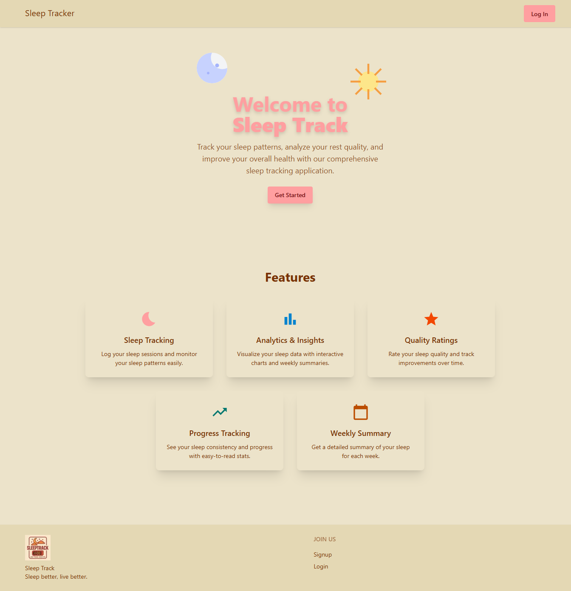
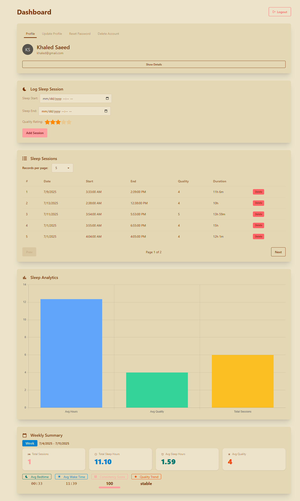

# 💤 Sleep Track Frontend

A simple, retro-styled web application for tracking your sleep, built with **Next.js** and **DaisyUI**.

## 🛠️ Tech Stack

- ⚛️ **Next.js** (React framework)
- 🎨 **Tailwind CSS** (utility-first CSS)
- 🕹️ **DaisyUI** (Tailwind CSS component library, retro theme)
- 🐻 **Zustand** (state management)
- 🔗 **Axios** (HTTP client)
- 📊 **Chart.js** & **react-chartjs-2** (data visualization)
- 🎯 **React Icons** (icon library)

## ✨ Features

- 📝 Log sleep sessions with start/end time and quality rating
- 📜 View sleep session history with pagination
- 📅 Weekly summary and analytics (average hours, quality, consistency score, trends)
- 📈 Interactive charts for sleep stats
- 🕹️ Retro design style using DaisyUI
- 📱 Responsive and mobile-friendly UI

## 🖼️ Demo


_Home page with retro design_


_Sleep dashboard with analytics and session list_

## 🔗 Backend

- [Sleep Track Backend Repo](https://github.com/KhaledSaeed18/sleep-track-backend)
  - 🐍 Built with **Python FastAPI**
  - 🗄️ Uses **PostgreSQL** for data storage

## ⚡ Installation

```bash
git clone https://github.com/KhaledSaeed18/sleep-track-frontend.git
cd sleep-track-frontend
pnpm install
```

## ⚙️ Environment Setup

Create a `.env.local` file in the root directory and set your backend API URL:

```
NEXT_PUBLIC_API_URL=http://localhost:8000
```

Adjust the URL as needed for your backend deployment.

## 🚀 Running the App

```bash
pnpm dev
```

Open [http://localhost:3000](http://localhost:3000) in your browser.

## 🎨 Customization

- DaisyUI theme can be changed in `global.css`
- Update API endpoints in hooks/services as needed
